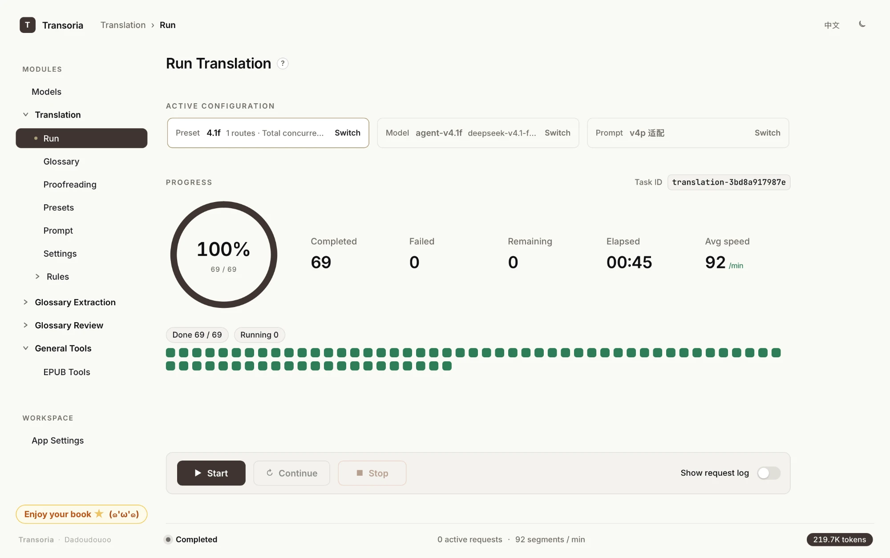
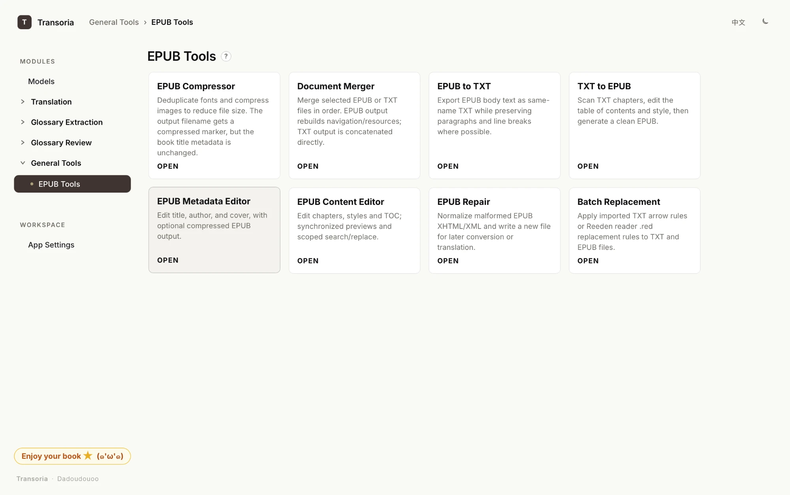

<p align="center">
  
</p>
<p align="center"><strong>Translate foreign-language novels into complete, ready-to-read ebooks — locally, with the models you choose.</strong></p>
<p align="center">
  <a href="https://github.com/oodadoudou/Transoria/releases/latest"></a>
  <a href="https://github.com/oodadoudou/Transoria/releases"></a>
  
</p>
<p align="center">
  <a href="README.md">English</a> |
  <a href="README.zh-CN.md">简体中文</a>
</p>



---

### Features

- **Structure-preserving translation** — EPUB or TXT in, the same book out: chapters, styles and layout intact, with resumable runs.
- **Consistent terminology** — extract, review and enforce a glossary so every name reads the same from the first page to the last.
- **Built-in proofreading** — every passage is checked against the source for untranslated text, omissions and inconsistent names, with one-click retranslation.
- **Bring your own model** — major providers and OpenAI-compatible endpoints, with presets, multi-route concurrency, rate limits and automatic fallback.
- **Complete EPUB toolkit** — edit content, batch-replace, compress, merge, convert, repair and update metadata.



### Why Transoria

- **Local-first** — your books and API keys stay on your machine; text is sent only to the model service you configure.
- **Built for long-form** — chunked, concurrent and resumable; failed requests retry only what is missing.
- **Faithful by design** — output stays aligned with the source paragraph by paragraph, instead of flattening and re-stitching text.
- **One workflow** — glossary, translation, proofreading and ebook cleanup in a single app.

### Installation

Download the latest build from [Releases](https://github.com/oodadoudou/Transoria/releases/latest).

| Platform | Download | Steps |
| -------- | -------- | ----- |
| macOS    | `Transoria.dmg` | Drag Transoria into Applications and launch it. |
| Windows  | `Transoria.zip` | Unblock the ZIP in File Properties, extract it, and run `Transoria.exe`. |

On first launch, a short setup guide helps you add a model and its API key.

### Run from source

Requires Python 3.11+ and Node.js 18+.

```bash
git clone https://github.com/oodadoudou/Transoria.git
cd Transoria
uv sync --extra gui --extra dev          # Windows: python -m pip install -e ".[gui,dev]"
cd frontend && npm install && cd ..
uv run --no-sync python app.py           # Windows: python app.py
```

### Community

Questions and feedback: QQ group **1104197845**.
