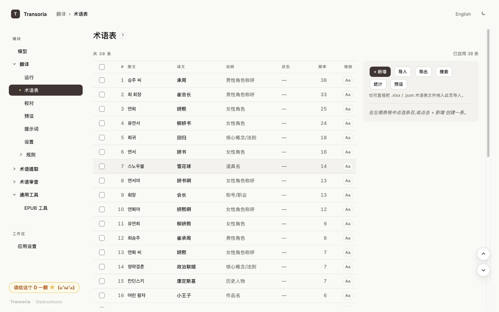
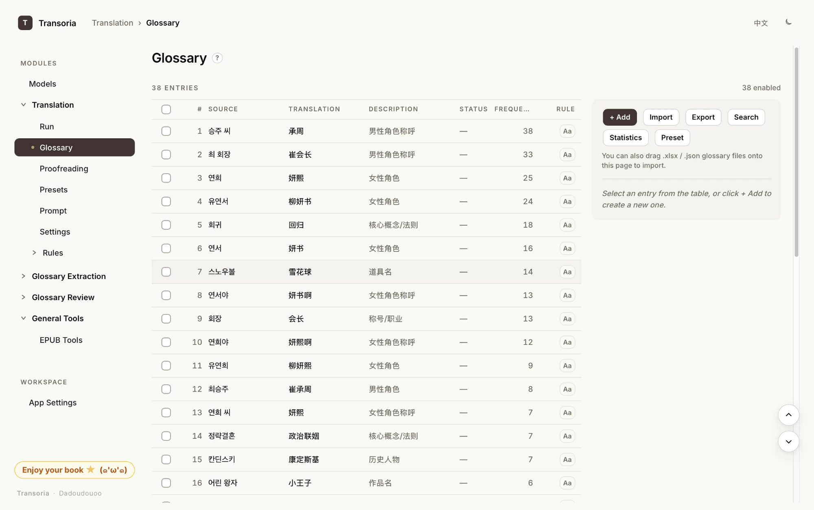
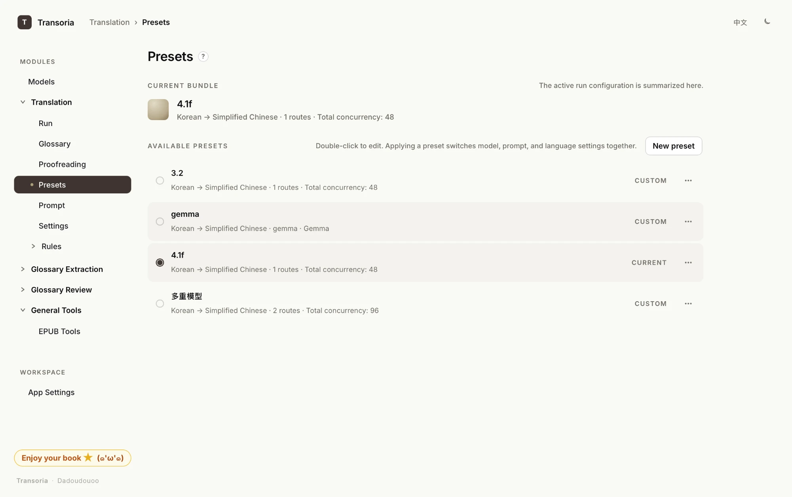
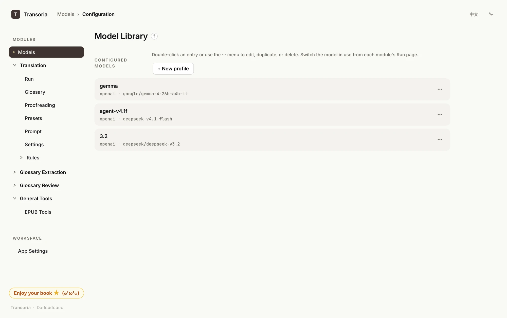

# Transoria

<p align="center">
  <strong><a href="#中文">中文</a></strong> ·
  <strong><a href="#english">English</a></strong> ·
  <strong><a href="https://github.com/oodadoudou/Transoria/releases">Download</a></strong>
</p>

<p align="center">
  
</p>

## 中文

Transoria 是一个本地桌面应用，用于翻译韩文 / 日文等外文小说并编辑 EPUB。

### 核心功能

- **翻译**：EPUB / TXT 分块翻译，输出与原书结构一致的译本，中断后可继续。
- **术语**：从原文提取术语、多轮审查，再导入翻译术语表，全书译名统一。
- **校对**：自动标出低置信度、原文残留和术语异常的段落，单条或批量重译。
- **模型与预设**：支持主流服务商和 OpenAI 兼容接口，预设一键切换模型、Prompt 和语言。
- **EPUB 工具**：内容编辑、批量替换、压缩、合并、格式转换、元数据编辑和修复。

### 核心优势

- **本地运行**：使用你自己的 API Key；书稿和译文保存在本机，只会发送给你配置的模型服务。
- **保留原书**：保持章节、段落、样式和排版，不是把正文拆成纯文本再拼回去。
- **质量把关**：逐段对齐原文，检查原文残留、漏译和译名不一致，问题集中到校对页处理。
- **又快又稳**：多线路并发、限速和兜底模型，请求失败只重试缺失部分。
- **一站完成**：从术语、翻译、校对到电子书整理，都在一个应用里。

### 快速开始

**下载安装（推荐）**：从 [Releases](https://github.com/oodadoudou/Transoria/releases) 下载最新版本。

- **macOS**：打开 `Transoria.dmg`，把应用拖入「应用程序」后启动。
- **Windows**：解压 `Transoria-windows.zip`（解压前在文件属性中勾选「解除锁定」），运行 `Transoria.exe`。

首次打开会引导你添加模型并填写 API Key，之后就能开始翻译。

**从源码运行**：需要 Python 3.11+ 和 Node.js 18+。

```bash
git clone https://github.com/oodadoudou/Transoria.git
cd Transoria
uv sync --extra gui --extra dev          # Windows: python -m pip install -e ".[gui,dev]"
cd frontend && npm install && cd ..
uv run --no-sync python app.py           # Windows: python app.py
```

### 截图

<table>
  <tr>
    <td></td>
    <td></td>
  </tr>
  <tr>
    <td></td>
    <td></td>
  </tr>
  <tr>
    <td colspan="2"></td>
  </tr>
</table>

---

## English

Transoria is a local desktop app for translating foreign-language novels (Korean, Japanese and more) and editing EPUBs.

### Core features

- **Translation**: chunked EPUB / TXT translation that outputs a book with the original structure; interrupted runs can continue.
- **Glossary**: extract terms from the source, review them over several rounds, and import them so names stay consistent across the book.
- **Proofreading**: flags low-confidence, untranslated and terminology-mismatched passages; retranslate one row or many.
- **Models and presets**: major providers and OpenAI-compatible APIs; presets switch model, prompt and language in one click.
- **EPUB tools**: content editing, batch replacement, compression, merging, conversion, metadata editing and repair.

### Why Transoria

- **Runs locally**: uses your own API keys; manuscripts and translations stay on your machine and are sent only to the model service you configure.
- **Keeps the book intact**: chapters, paragraphs, styles and layout are preserved instead of flattening the text and stitching it back.
- **Built-in quality checks**: paragraph-by-paragraph alignment with checks for leftover source text, omissions and inconsistent names, all gathered in Proofreading.
- **Fast and resilient**: multi-route concurrency, rate limits and a fallback model; failed requests retry only what is missing.
- **All in one place**: glossary, translation, proofreading and ebook cleanup in a single app.

### Quick start

**Download (recommended)**: get the latest build from [Releases](https://github.com/oodadoudou/Transoria/releases).

- **macOS**: open `Transoria.dmg`, drag the app into Applications, and launch it.
- **Windows**: unzip `Transoria-windows.zip` (unblock it in File Properties first) and run `Transoria.exe`.

On first launch, a short guide helps you add a model and its API key; then you're ready to translate.

**Run from source**: requires Python 3.11+ and Node.js 18+.

```bash
git clone https://github.com/oodadoudou/Transoria.git
cd Transoria
uv sync --extra gui --extra dev          # Windows: python -m pip install -e ".[gui,dev]"
cd frontend && npm install && cd ..
uv run --no-sync python app.py           # Windows: python app.py
```

### Screenshots

<table>
  <tr>
    <td></td>
    <td></td>
  </tr>
  <tr>
    <td></td>
    <td></td>
  </tr>
  <tr>
    <td colspan="2"></td>
  </tr>
</table>
