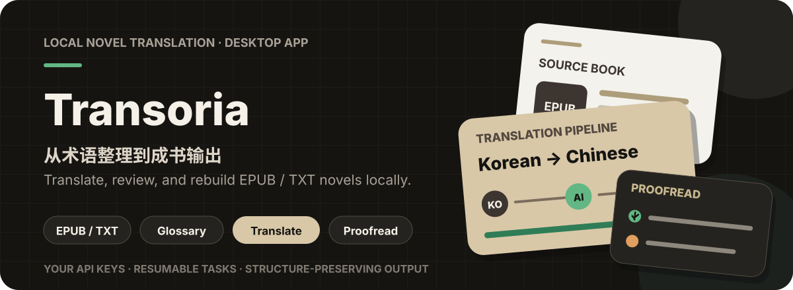
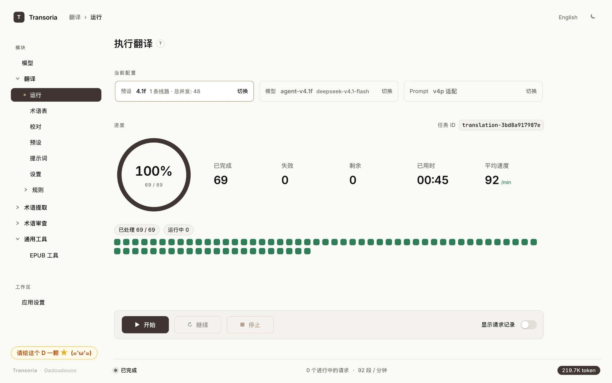
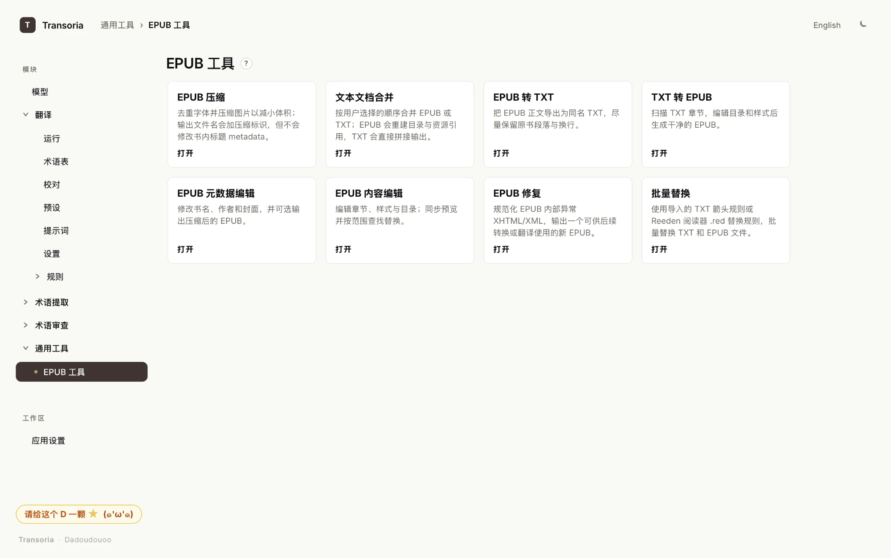

<p align="center">
  
</p>
<p align="center"><strong>用你选择的模型，在本地把外文小说译成排版完整、即可阅读的电子书。</strong></p>
<p align="center">
  <a href="https://github.com/oodadoudou/Transoria/releases/latest"></a>
  <a href="https://github.com/oodadoudou/Transoria/releases"></a>
  
</p>
<p align="center">
  <a href="README.md">English</a> |
  <a href="README.zh-CN.md">简体中文</a>
</p>



---

### 功能

- **保留原书结构的翻译**：输入 EPUB 或 TXT，输出章节、样式与排版完整的同一本书，中断后可续译。
- **一致的术语体系**：提取、审校并应用术语表，人名与专有名词全书统一。
- **内置校对**：逐段比对原文，定位原文残留、漏译与译名不一致，并支持一键重译。
- **自选模型**：兼容主流服务商与 OpenAI 兼容接口，支持预设、多线路并发、速率控制与自动兜底。
- **完整的 EPUB 工具链**：内容编辑、批量替换、压缩、合并、格式转换、修复与元数据编辑。



### 为什么选择 Transoria

- **本地优先**：书稿与 API Key 仅保存在本机，文本只发送至你配置的模型服务。
- **为长篇而生**：分块并发、断点续译，失败请求只补译缺失部分。
- **忠于原文**：译文与原文逐段对齐，而不是把正文拆散再拼接。
- **一体化工作流**：术语、翻译、校对与电子书整理，在同一个应用中完成。

### 安装

从 [Releases](https://github.com/oodadoudou/Transoria/releases/latest) 下载最新版本。

| 平台 | 下载文件 | 步骤 |
| ---- | -------- | ---- |
| macOS   | `Transoria.dmg` | 将 Transoria 拖入「应用程序」后启动。 |
| Windows | `Transoria.zip` | 在文件属性中解除锁定，解压后运行 `Transoria.exe`。 |

首次启动时，设置向导会引导你添加模型和 API Key。

### 从源码运行

需要 Python 3.11+ 与 Node.js 18+。

```bash
git clone https://github.com/oodadoudou/Transoria.git
cd Transoria
uv sync --extra gui --extra dev          # Windows: python -m pip install -e ".[gui,dev]"
cd frontend && npm install && cd ..
uv run --no-sync python app.py           # Windows: python app.py
```

### 社区

问题反馈 QQ 群：**1104197845**
